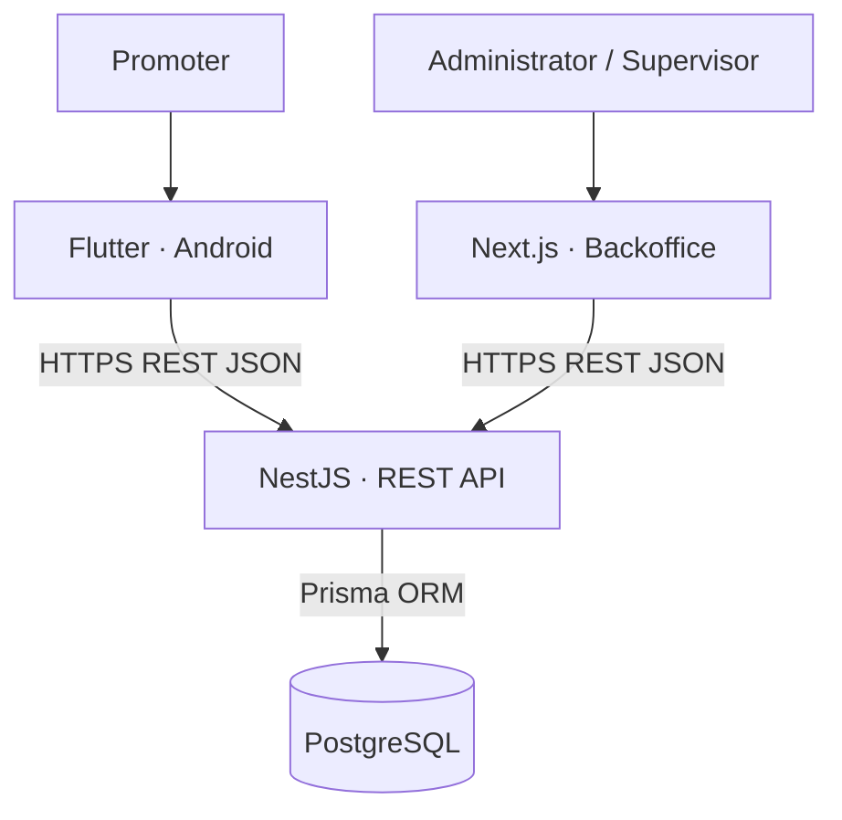

# Software architecture — C4 level 2 (text)

- **API:** authority for identity, permissions, validation and rules.
- **Web:** administrative interface; do not duplicate backend authorization rules.
- **Mobile:** promoter operations, data restricted to authorized stores.
- **Prisma:** library within the NestJS process, not a separate C4 container.
- **OpenAPI:** technical contract generated/published by the API; Flutter and web consume a pinned version, not invented contracts.
- **Repositories:** independent; coordinate changes by HU and linked issues.

## API layers
`controller` (HTTP/DTO) → `service` (rules/authorization) → `repository/Prisma` (persistence). Initial modules: auth, users, stores, products, assignments, receptions.

## Security
Signed JWT, expiration validation, secure hashing, role guards and DB-backed store assignment checks on every protected operation. Never trust a client-supplied `userId` as the actor.

## Environments
Local first; reproducible demo subject to availability. Remote infrastructure is not selected. No registry or Cloud Storage as MVP dependencies.
